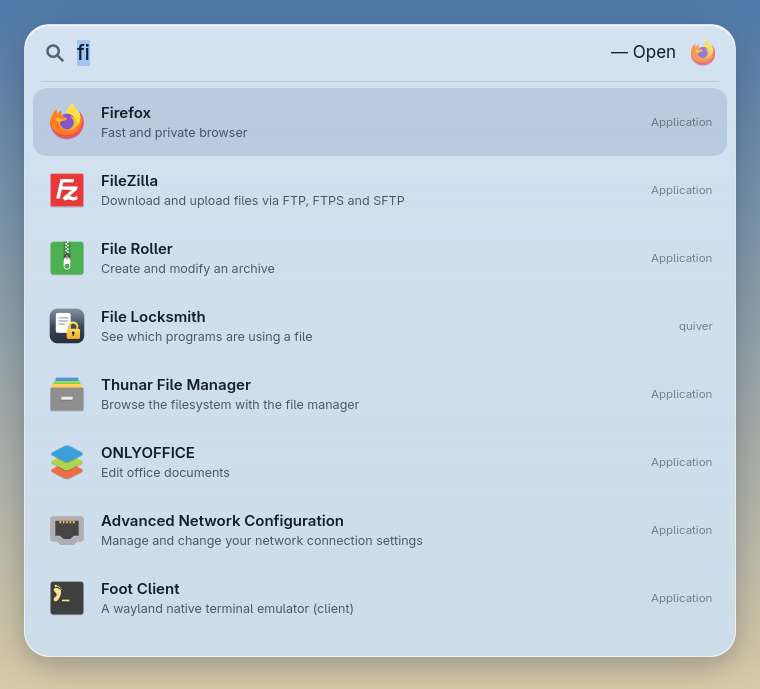
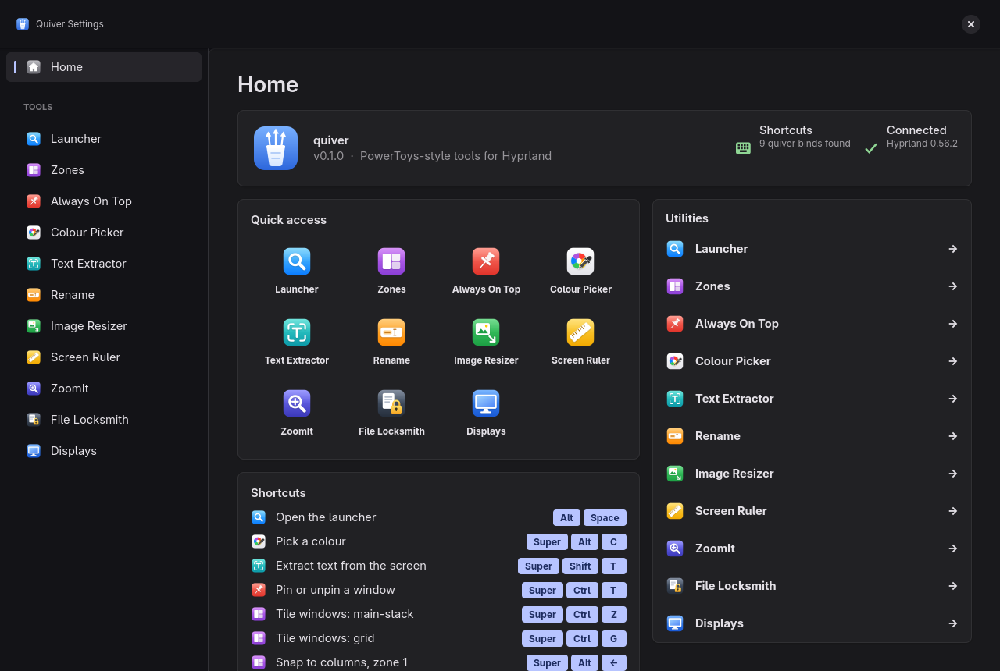
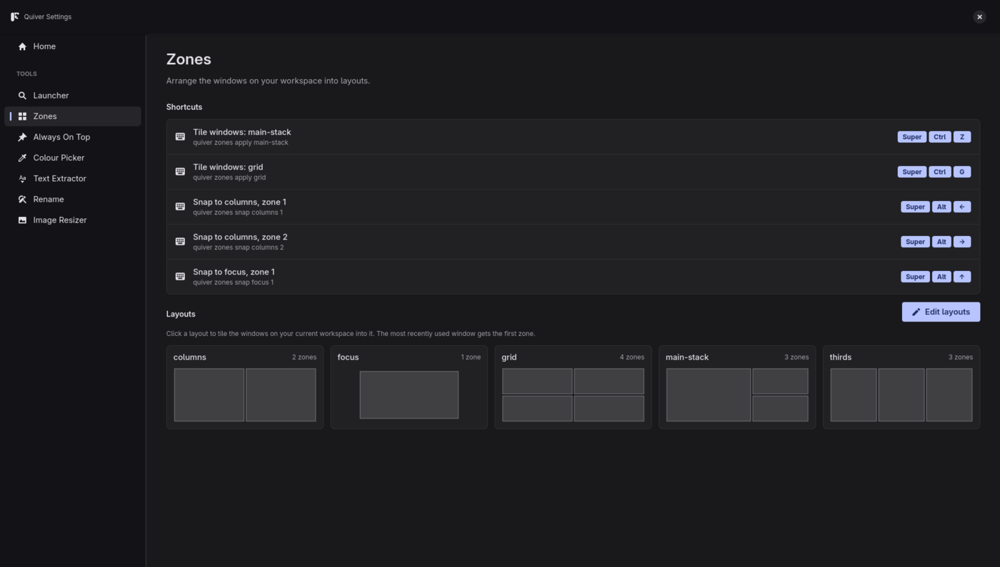
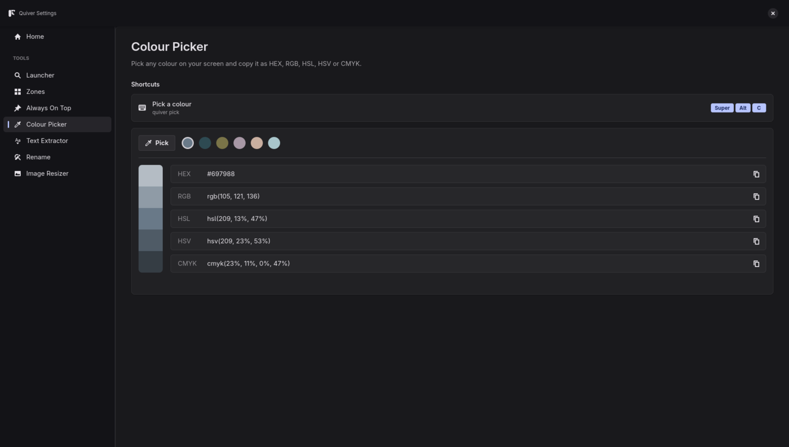

# quiver
a boredom driven microsoft powertoys replacement for linux/hyprland





<p>
  
  
</p>

One binary, eleven tools, and a settings window for all of them:

| Command | PowerToys equivalent | What it does |
| --- | --- | --- |
| `quiver` / `quiver settings` | PowerToys Settings | Settings window with a page for every tool |
| `quiver run` | PowerToys Run | Spotlight-style launcher for apps, quiver's tools, `=` maths and `>` shell commands |
| `quiver zones` | FancyZones | Snap windows into predefined layouts |
| `quiver rename` | PowerRename | Bulk-rename files with find & replace, regex and counters |
| `quiver top` | Always On Top | Pin the focused window above everything else |
| `quiver pick` | Color Picker | Click any pixel, its colour is copied (`--format hex/rgb/hsl/hsv/cmyk`) |
| `quiver ocr` | Text Extractor | Drag a box over the screen, the text inside is copied (`--lang eng+deu`) |
| `quiver resize` | Image Resizer | Shrink images to a preset, exact size or percentage |
| `quiver ruler` | Screen Ruler | Measure pixel distances on screen, with edge detection |
| `quiver zoom` / `draw` / `record` | ZoomIt | Zoom the screen, draw on it, and record it |
| `quiver locksmith` | File Locksmith | Show which processes are using a file or folder |
| `quiver settings display` | (Windows display settings) | Resolution, refresh rate, scale, rotation and layout of monitors |

Needs Hyprland 0.55 or newer (the Lua config version).

## Install

### Arch Linux

quiver isn't on the AUR yet, but the repo has ready PKGBUILDs. To build and install the latest commit as a package:

```bash
cd packaging/aur/quiver-git && makepkg -si
```

This also installs a "Quiver" menu entry and icon.

### Debian 13 / Ubuntu 25.04 and newer

Download the `.deb` from the [latest release](https://github.com/alon3wolfus/quiver/releases/latest) and install it:

```bash
sudo apt install ./quiver_0.1.0-1_amd64.deb
```

Hyprland 0.55+ comes from `trixie-backports` on Debian 13. The `.deb` recommends hyprland, hyprpicker, grim, slurp, wl-clipboard, tesseract and libnotify.

### From source

```bash
sudo pacman -S --needed rustup gtk4 gtk4-layer-shell hyprpicker grim slurp wl-clipboard tesseract tesseract-data-eng libnotify gpu-screen-recorder plocate
rustup default stable
cargo install --path .
```

This puts `quiver` in `~/.cargo/bin`. For fish, add that to your PATH with `fish_add_path ~/.cargo/bin`. With a package, `quiver` is in `/usr/bin` and the keybinds below can use plain `"quiver"` instead of the full path.

### Building the packages

- **Arch:** `packaging/aur/quiver/PKGBUILD` (tagged releases) and `packaging/aur/quiver-git/PKGBUILD` (latest commit), ready for the AUR. For `quiver`, push a `vX.Y.Z` tag first, then run `updpkgsums` and `makepkg --printsrcinfo > .SRCINFO` in that folder.
- **.deb:** `cargo install cargo-deb && cargo deb` writes `target/debian/quiver_*.deb`. Pushing a `v*` tag runs `.github/workflows/release.yml`, which builds the `.deb` and a plain binary on Debian 13 and attaches them to the GitHub release.

## Hyprland keybinds

Add to your Hyprland Lua config (with caelestia, `~/.config/caelestia/hypr-user.lua`). These keys are free in a default caelestia setup; check `hyprctl binds` for clashes with your own.

```lua
local quiver = os.getenv("HOME") .. "/.cargo/bin/quiver"

-- Keep the launcher loaded in the background so ALT + SPACE opens it instantly
hl.on("hyprland.start", function()
    hl.exec_cmd(quiver .. " run --daemon")
end)

hl.bind("ALT + SPACE", hl.dsp.exec_cmd(quiver .. " run"))                  -- Launcher
hl.bind("SUPER + ALT + C", hl.dsp.exec_cmd(quiver .. " pick"))             -- Colour picker
hl.bind("SUPER + SHIFT + T", hl.dsp.exec_cmd(quiver .. " ocr"))            -- Text extractor
hl.bind("SUPER + CTRL + T", hl.dsp.exec_cmd(quiver .. " top"))             -- Always on top

-- Zones
hl.bind("SUPER + CTRL + Z", hl.dsp.exec_cmd(quiver .. " zones apply main-stack"))
hl.bind("SUPER + CTRL + G", hl.dsp.exec_cmd(quiver .. " zones apply grid"))
-- caelestia binds SUPER + ALT + arrows to resizing; free them in hypr-vars.lua first
hl.bind("SUPER + ALT + Left", hl.dsp.exec_cmd(quiver .. " zones snap columns 1"))
hl.bind("SUPER + ALT + Right", hl.dsp.exec_cmd(quiver .. " zones snap columns 2"))
hl.bind("SUPER + ALT + Up", hl.dsp.exec_cmd(quiver .. " zones snap focus 1"))

-- Launcher pops in with frosted-glass blur; ignore_alpha keeps the blur off the
-- transparent space around the bar
hl.layer_rule({ match = { namespace = "quiver" }, animation = "popin 80%", blur = true, ignore_alpha = 0.2 })
```

## Settings window (`quiver`)

Run `quiver` with no command (or `quiver settings`, or search "settings" in the launcher). Like PowerToys Settings, it has:

- **Home**: Hyprland connection status, quick access to every tool, all your quiver keybinds, and a utilities list
- **Colour Picker**: pick a colour, see recent picks, shades, and HEX / RGB / HSL / HSV / CMYK values with copy buttons
- **Rename**: find & replace with a live original → renamed preview, then Apply
- **Zones**: every layout drawn as a card; click one to tile your workspace, or edit the layouts file
- **Always On Top**: pin or unpin your open windows
- **Text Extractor**, **Image Resizer** and **Launcher** pages

Each tool page shows the keybinds it found in your Hyprland Lua config. The window follows your GTK theme's colours.

## Launcher (`quiver run`)

The launcher stays loaded in the background after the first use, so it opens in well under 0.1 s (GTK takes over a second to start from scratch). `quiver run` asks the background launcher to show itself and exits immediately; pressing the key again while it's open hides it. `quiver run --daemon` starts it hidden, e.g. at login, so even the first open is instant.

A floating, Spotlight-style search bar with app icons. The round buttons next to it limit results to apps, quiver's tools, commands or maths; click one again to go back to everything. With blur on (see the `layer_rule` above) it looks like frosted glass.

- Type to fuzzy-search installed apps (`vsc` finds Visual Studio Code) and quiver's own tools (`color`, `ocr`, `pin`, `zones`)
- Type maths like `2*21` or `=sqrt(2)`, Enter copies the result
- Type `$` to search files in your home folder, e.g. `$report` (Enter opens it, Shift+Enter shows it in its folder). quiver keeps an index of your home folder in memory, skipping hidden folders and build/dependency folders, and refreshes it in the background.
- Type `$$` to search every file on the system through [plocate](https://plocate.sesse.net/). Install it once with `sudo pacman -S plocate && sudo updatedb`; its timer keeps the database up to date.
- Type `>` to list only the commands on your PATH, e.g. `>htop` or `>ls -la`
  - Enter runs the command, Shift+Enter runs it in your terminal and keeps it open
- Up/Down or Tab to move, Enter to launch, Escape to close

## Zones (`quiver zones`)

Built-in layouts: `columns`, `thirds`, `main-stack`, `grid`, `focus`.

- `quiver zones list` shows them
- `quiver zones apply <layout>` tiles every window on the current workspace, most recently focused first
- `quiver zones snap <layout> <n>` moves just the focused window into zone `n`
- Add `--dry-run` to print the Hyprland commands instead of running them

Windows placed in zones become floating. To make your own layouts, run `quiver zones init` and edit `~/.config/quiver/layouts.toml`:

```toml
gap = 10
[layouts]
# [x, y, width, height] in percent of the screen, excluding bars
wide-left = [[0, 0, 70, 100], [70, 0, 30, 100]]
```

## Rename (`quiver rename`)

Shows a preview first. Nothing changes until you add `--yes`.

```bash
quiver rename draft final *.txt
quiver rename --regex '^IMG_(\d+)' 'trip-{n}-$1' *.jpg --yes
```

- `{n}` becomes a counter (1, 2, 3...), and with `--regex`, `$1` is the first capture group
- `--ignore-case` matches regardless of upper/lower case
- Refuses to overwrite existing files or give two files the same name

## Always On Top (`quiver top`)

Pins the focused window so it stays above other windows and follows you to every workspace. Run it again to unpin.

Hyprland can only pin floating windows, so a tiled window is floated exactly where its tile was while pinned. Unpinning puts it back into the tiling layout on the workspace you're on. Windows that were already floating stay floating.

## Resize (`quiver resize`)

```bash
quiver resize photo.jpg
quiver resize *.png --size 50%
quiver resize scan.jpg --size 1200x1200 --overwrite
```

- Sizes: `small` (854×480), `medium` (1366×768, the default), `large` (1920×1080), `phone` (320×568), `WIDTHxHEIGHT` or `N%`
- Keeps the aspect ratio and never enlarges with a fixed size
- Saves next to the original as `photo (Medium).jpg`, unless you pass `--overwrite`

## Screen Ruler (`quiver ruler`)

Freezes the focused monitor. Moving the mouse draws lines out to the nearest colour edge in each direction with the width × height in pixels; drag to measure a box; click to copy the size (e.g. `320x48`); Esc closes.

## ZoomIt (`quiver zoom`, `quiver draw`, `quiver record`)

- `quiver zoom in` / `out` / `reset` / `toggle` zooms the screen around the mouse (Hyprland's built-in zoom)
- `quiver draw` freezes the screen so you can draw on it: drag to draw, Shift for lines, Ctrl for boxes, R G B Y O P W K for colours, +/− for size, Ctrl+Z undo, E clear, Ctrl+C copy, Ctrl+S save to Pictures, Esc close
- `quiver record` starts recording the focused monitor to your Videos folder with gpu-screen-recorder; run it again to stop. `--region` lets you drag an area first

## File Locksmith (`quiver locksmith <paths>`)

Lists the processes that have a file open, use a folder as their working directory, or have a file loaded. The settings page adds an End task button. Other users' processes only show when run as root.

## Displays (`quiver settings display`)

Change each monitor's resolution and refresh rate, scale, rotation, position, or turn it off. Changes apply live and, like Windows, revert after 15 seconds unless you click Keep. "Save as default" writes `~/.config/quiver/monitors.lua`; load it at login by adding this to your Hyprland config:

```lua
dofile(os.getenv("HOME") .. "/.config/quiver/monitors.lua")
```

The page also sets the text size for GTK apps.

## License

GPL-3.0. See [LICENSE](LICENSE).
