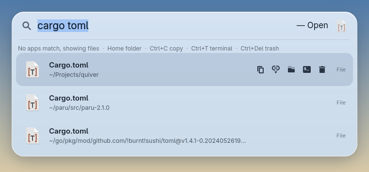
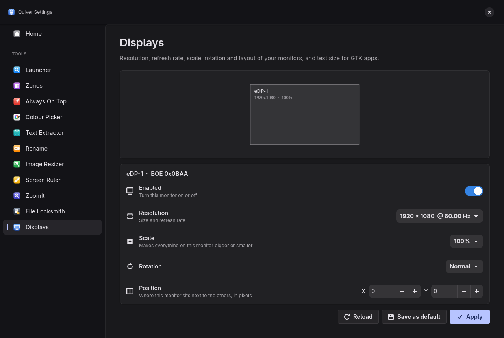
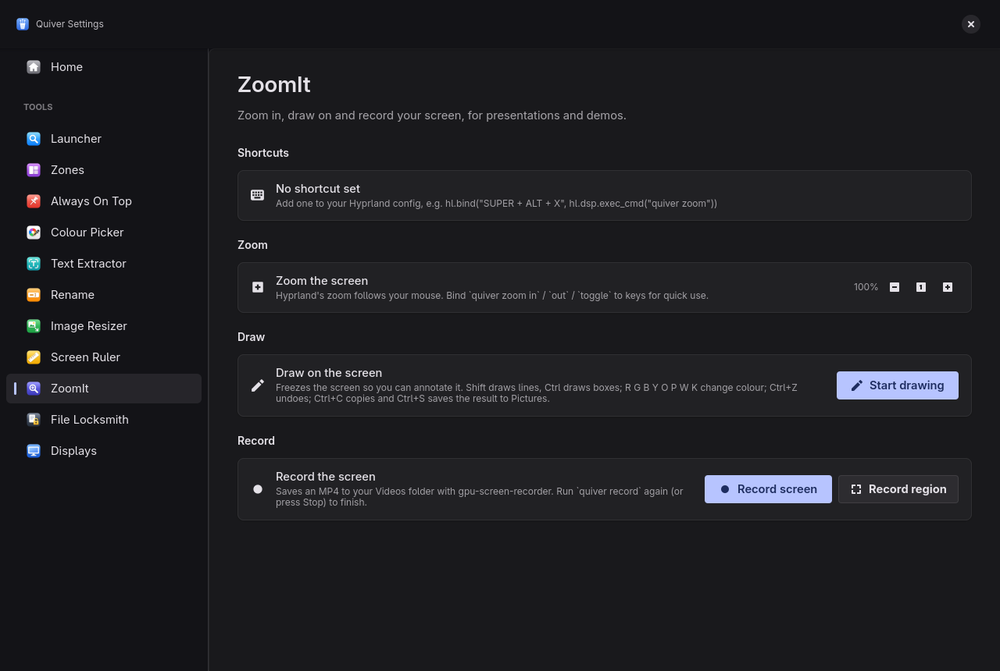
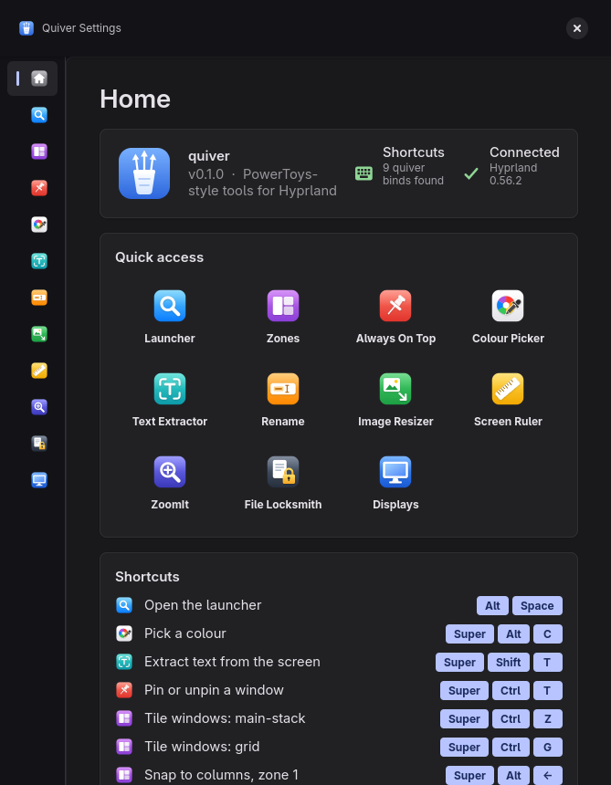
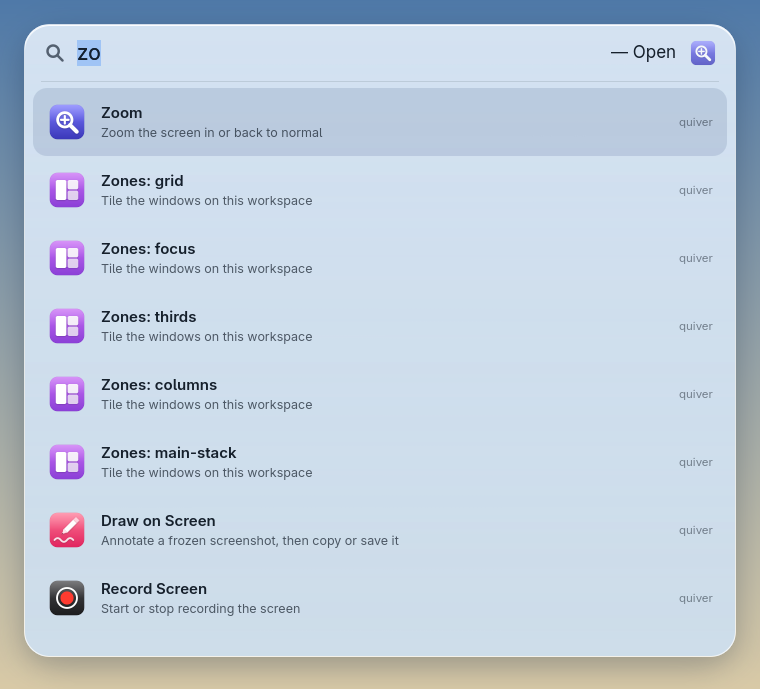

# quiver
a boredom driven microsoft powertoys replacement for linux/hyprland

<p>
  
  
</p>


<p>
  
  
</p>
<p>
  
  
</p>

One binary, eleven tools, and a settings window for all of them:

| Command | PowerToys equivalent | What it does |
| --- | --- | --- |
| `quiver` / `quiver settings` | PowerToys Settings | Settings window with a page for every tool |
| `quiver run` | PowerToys Run | Spotlight-style launcher for apps, quiver's tools, `=` maths and `>` shell commands |
| `quiver zones` | FancyZones | Snap windows into predefined layouts |
| `quiver rename` | PowerRename | Bulk-rename files with find & replace, regex and counters |
| `quiver top` | Always On Top | Pin the focused window above everything else |
| `quiver pick` | Color Picker | Click any pixel, its colour is copied (`--format hex/rgb/hsl/hsv/cmyk`) |
| `quiver ocr` | Text Extractor | Drag a box over the screen, the text inside is copied (`--lang eng+deu`) |
| `quiver resize` | Image Resizer | Shrink images to a preset, exact size or percentage |
| `quiver ruler` | Screen Ruler | Measure pixel distances on screen, with edge detection |
| `quiver zoom` / `draw` / `record` | ZoomIt | Zoom the screen, draw on it, and record it |
| `quiver locksmith` | File Locksmith | Show which processes are using a file or folder |
| `quiver settings display` | (Windows display settings) | Resolution, refresh rate, scale, rotation and layout of monitors |

Needs Hyprland 0.55 or newer (the Lua config version).

## Install

### Arch Linux, Debian 13 and Ubuntu 25.04+ (one command)

```bash
curl -fsSL https://raw.githubusercontent.com/alon3wolfus/quiver/main/install.sh | sh
```

[install.sh](install.sh) downloads the latest release's Arch package or `.deb` and installs it with pacman or apt, which also pull in the dependencies. On Arch it offers the optional extras (OCR language data, notifications, screen recording, whole-system file search). It installs a normal package, so updating is running it again, and removing is `sudo pacman -R quiver` or `sudo apt remove quiver`. Read the script first if you like; it's short.

### Arch Linux, by hand

Download `quiver-*-x86_64.pkg.tar.zst` from the [latest release](https://github.com/alon3wolfus/quiver/releases/latest), then:

```bash
sudo pacman -U quiver-*-x86_64.pkg.tar.zst
```

Or build the latest commit yourself with the PKGBUILD in the repo:

```bash
cd packaging/aur/quiver-git && makepkg -si
```

### Debian 13 / Ubuntu 25.04 and newer, by hand

Download `quiver_*_amd64.deb` from the [latest release](https://github.com/alon3wolfus/quiver/releases/latest), then:

```bash
sudo apt install ./quiver_*_amd64.deb
```

Hyprland 0.55+ comes from `trixie-backports` on Debian 13. The `.deb` recommends hyprland, hyprpicker, grim, slurp, wl-clipboard, tesseract, libnotify and plocate. Older releases (Debian 12, Ubuntu 24.04) lack gtk4-layer-shell, so build from source there.

All installs add a "Quiver" app menu entry and icon.

### From source

```bash
sudo pacman -S --needed rustup gtk4 gtk4-layer-shell hyprpicker grim slurp wl-clipboard tesseract tesseract-data-eng libnotify gpu-screen-recorder plocate
rustup default stable
cargo install --path .
```

This puts `quiver` in `~/.cargo/bin`. For fish, add that to your PATH with `fish_add_path ~/.cargo/bin`. With a package, `quiver` is in `/usr/bin` and the keybinds below can use plain `"quiver"` instead of the full path.

### Building the packages

- **Arch:** `packaging/aur/quiver/PKGBUILD` (tagged releases) and `packaging/aur/quiver-git/PKGBUILD` (latest commit), ready for the AUR. For `quiver`, push a `vX.Y.Z` tag first, then run `updpkgsums` and `makepkg --printsrcinfo > .SRCINFO` in that folder.
- **.deb:** `cargo install cargo-deb && cargo deb` writes `target/debian/quiver_*.deb`.
- **Releases:** bump `version` in `Cargo.toml` (and `pkgver` in the PKGBUILD), then push a `vX.Y.Z` tag. `.github/workflows/release.yml` builds the `.deb` on Debian 13, the Arch package on Arch, and a plain binary, and attaches them to the GitHub release, where install.sh finds them.

## Hyprland keybinds

Add to your Hyprland Lua config (with caelestia, `~/.config/caelestia/hypr-user.lua`). These keys are free in a default caelestia setup; check `hyprctl binds` for clashes with your own.

```lua
local quiver = os.getenv("HOME") .. "/.cargo/bin/quiver"

-- Keep the launcher loaded in the background so ALT + SPACE opens it instantly
hl.on("hyprland.start", function()
    hl.exec_cmd(quiver .. " run --daemon")
end)

hl.bind("ALT + SPACE", hl.dsp.exec_cmd(quiver .. " run"))                  -- Launcher
hl.bind("SUPER + ALT + C", hl.dsp.exec_cmd(quiver .. " pick"))             -- Colour picker
hl.bind("SUPER + SHIFT + T", hl.dsp.exec_cmd(quiver .. " ocr"))            -- Text extractor
hl.bind("SUPER + CTRL + T", hl.dsp.exec_cmd(quiver .. " top"))             -- Always on top

-- Zones
hl.bind("SUPER + CTRL + Z", hl.dsp.exec_cmd(quiver .. " zones apply main-stack"))
hl.bind("SUPER + CTRL + G", hl.dsp.exec_cmd(quiver .. " zones apply grid"))
-- caelestia binds SUPER + ALT + arrows to resizing; free them in hypr-vars.lua first
hl.bind("SUPER + ALT + Left", hl.dsp.exec_cmd(quiver .. " zones snap columns 1"))
hl.bind("SUPER + ALT + Right", hl.dsp.exec_cmd(quiver .. " zones snap columns 2"))
hl.bind("SUPER + ALT + Up", hl.dsp.exec_cmd(quiver .. " zones snap focus 1"))

-- Launcher pops in with frosted-glass blur; ignore_alpha keeps the blur off the
-- transparent space around the bar
hl.layer_rule({ match = { namespace = "quiver" }, animation = "popin 80%", blur = true, ignore_alpha = 0.2 })
```

## Settings window (`quiver`)

Run `quiver` with no command (or `quiver settings`, or search "settings" in the launcher). Like PowerToys Settings, it has:

- **Home**: Hyprland connection status, quick access to every tool, all your quiver keybinds, and a utilities list
- **Colour Picker**: pick a colour, see recent picks, shades, and HEX / RGB / HSL / HSV / CMYK values with copy buttons
- **Rename**: find & replace with a live original → renamed preview, then Apply
- **Zones**: every layout drawn as a card; click one to tile your workspace, or edit the layouts file
- **Always On Top**: pin or unpin your open windows
- **Text Extractor**, **Image Resizer** and **Launcher** pages

Each tool page shows the keybinds it found in your Hyprland Lua config. The window follows your GTK theme's colours, and every tool has its own colour icon.

It works tiled at any size: below about 1150 px wide the home page stacks into one column, and below 900 px the sidebar shrinks to just icons.



## Launcher (`quiver run`)

The launcher stays loaded in the background after the first use, so it opens in well under 0.1 s (GTK takes over a second to start from scratch). `quiver run` asks the background launcher to show itself and exits immediately; pressing the key again while it's open hides it. `quiver run --daemon` starts it hidden, e.g. at login, so even the first open is instant.

A floating, Spotlight-style search bar with app icons. The round buttons next to it limit results to apps, quiver's tools, commands or maths; click one again to go back to everything. With blur on (see the `layer_rule` above) it looks like frosted glass.

- Type to fuzzy-search installed apps (`vsc` finds Visual Studio Code) and quiver's own tools (`color`, `ocr`, `pin`, `zones`)
- Type maths like `2*21` or `=sqrt(2)`, Enter copies the result
- If nothing in your apps or tools matches, the launcher searches files in your home folder instead. Type `$` to search only files, e.g. `$report`. quiver keeps an index of your home folder in memory, skipping hidden folders and build/dependency folders, and refreshes it in the background.
- With a file selected: Enter opens it, Shift+Enter shows it in its folder, Ctrl+C copies the file (paste it in a file manager), Ctrl+Shift+C copies its path, Ctrl+T opens a terminal there and Ctrl+Delete moves it to the Trash. The same actions are buttons on the row.
- Type `$$` to search every file on the system through [plocate](https://plocate.sesse.net/). Install it once with `sudo pacman -S plocate && sudo updatedb`; its timer keeps the database up to date.
- Type `>` to list only the commands on your PATH, e.g. `>htop` or `>ls -la`
  - Enter runs the command, Shift+Enter runs it in your terminal and keeps it open
- Up/Down or Tab to move, Enter to launch, Escape to close
- It learns: if you pick the same result for the same search 3 times, it moves to the top for that search, even if it was 2nd or 3rd



## Zones (`quiver zones`)

Built-in layouts: `columns`, `thirds`, `main-stack`, `grid`, `focus`.

- `quiver zones list` shows them
- `quiver zones apply <layout>` tiles every window on the current workspace, most recently focused first
- `quiver zones snap <layout> <n>` moves just the focused window into zone `n`
- Add `--dry-run` to print the Hyprland commands instead of running them

Windows placed in zones become floating. To make your own layouts, run `quiver zones init` and edit `~/.config/quiver/layouts.toml`:

```toml
gap = 10
[layouts]
# [x, y, width, height] in percent of the screen, excluding bars
wide-left = [[0, 0, 70, 100], [70, 0, 30, 100]]
```

## Rename (`quiver rename`)

Shows a preview first. Nothing changes until you add `--yes`.

```bash
quiver rename draft final *.txt
quiver rename --regex '^IMG_(\d+)' 'trip-{n}-$1' *.jpg --yes
```

- `{n}` becomes a counter (1, 2, 3...), and with `--regex`, `$1` is the first capture group
- `--ignore-case` matches regardless of upper/lower case
- Refuses to overwrite existing files or give two files the same name

## Always On Top (`quiver top`)

Pins the focused window so it stays above other windows and follows you to every workspace. Run it again to unpin.

Hyprland can only pin floating windows, so a tiled window is floated exactly where its tile was while pinned. Unpinning puts it back into the tiling layout on the workspace you're on. Windows that were already floating stay floating.

## Resize (`quiver resize`)

```bash
quiver resize photo.jpg
quiver resize *.png --size 50%
quiver resize scan.jpg --size 1200x1200 --overwrite
```

- Sizes: `small` (854×480), `medium` (1366×768, the default), `large` (1920×1080), `phone` (320×568), `WIDTHxHEIGHT` or `N%`
- Keeps the aspect ratio and never enlarges with a fixed size
- Saves next to the original as `photo (Medium).jpg`, unless you pass `--overwrite`

## Screen Ruler (`quiver ruler`)

Freezes the focused monitor. Moving the mouse draws lines out to the nearest colour edge in each direction with the width × height in pixels; drag to measure a box; click to copy the size (e.g. `320x48`); Esc closes.

## ZoomIt (`quiver zoom`, `quiver draw`, `quiver record`)

- `quiver zoom in` / `out` / `reset` / `toggle` zooms the screen around the mouse (Hyprland's built-in zoom)
- `quiver draw` freezes the screen so you can draw on it: drag to draw, Shift for lines, Ctrl for boxes, R G B Y O P W K for colours, +/− for size, Ctrl+Z undo, E clear, Ctrl+C copy, Ctrl+S save to Pictures, Esc close
- `quiver record` starts recording the focused monitor to your Videos folder with gpu-screen-recorder; run it again to stop. `--region` lets you drag an area first

## File Locksmith (`quiver locksmith <paths>`)

Lists the processes that have a file open, use a folder as their working directory, or have a file loaded. The settings page adds an End task button. Other users' processes only show when run as root.

## Displays (`quiver settings display`)

Change each monitor's resolution and refresh rate, scale, rotation, position, or turn it off. Changes apply live and, like Windows, revert after 15 seconds unless you click Keep. "Save as default" writes `~/.config/quiver/monitors.lua`; load it at login by adding this to your Hyprland config:

```lua
dofile(os.getenv("HOME") .. "/.config/quiver/monitors.lua")
```

The page also sets the text size for GTK apps.

## Full reference

<details>
<summary><b>Everything quiver does, in detail</b> (click to expand). Written to be complete, so you can also paste this README into an AI assistant and ask it how to do something.</summary>

### Overview

quiver is a single Rust binary (GTK4 + gtk4-layer-shell) for Hyprland 0.55+ with the Lua config. Every tool is a subcommand. Tools that act on the screen are meant to be bound to keys in Hyprland. `quiver` with no command opens the settings window. All tools also appear in the launcher (`quiver run`) under their names.

quiver talks to Hyprland through `hyprctl` (`hyprctl -j` queries, plus `hyprctl eval` / `hyprctl dispatch` with Lua such as `hl.dsp.exec_cmd(...)`), so it needs to run inside a Hyprland session.

### Commands at a glance

| Command | Options | Result |
| --- | --- | --- |
| `quiver` | | Opens the settings window on Home |
| `quiver settings [PAGE]` | `PAGE`: `home`, `launcher`, `zones`, `top`, `picker`, `ocr`, `rename`, `resize`, `ruler`, `zoomit`, `locksmith`, `display` | Opens the settings window on that page |
| `quiver run` | `--daemon` | Shows/hides the launcher; `--daemon` starts it hidden in the background |
| `quiver pick` | `-f, --format hex\|rgb\|hsl\|hsv\|cmyk` (default `hex`) | Click a pixel; the colour is copied and added to the history |
| `quiver ocr` | `-l, --lang eng` (e.g. `eng+deu`) | Drag a box; its text is copied |
| `quiver zones list` | | Prints the layouts |
| `quiver zones apply LAYOUT` | `--dry-run` | Tiles every window on the current workspace into LAYOUT |
| `quiver zones snap LAYOUT ZONE` | `--dry-run` | Moves the focused window into zone ZONE (from 1) |
| `quiver zones init` | | Writes `~/.config/quiver/layouts.toml` to edit |
| `quiver top` | | Pins/unpins the focused window above all others |
| `quiver rename FIND REPLACE FILES...` | `-r/--regex`, `-i/--ignore-case`, `-y/--yes` | Previews renames; `--yes` does them |
| `quiver resize FILES...` | `-s/--size` (default `medium`), `--overwrite` | Writes resized copies |
| `quiver ruler` | | Full-screen pixel ruler |
| `quiver draw` | | Draw on a frozen screenshot |
| `quiver zoom [in\|out\|reset\|toggle]` | default `toggle` | Zooms the screen around the mouse |
| `quiver record` | `--region` | Starts recording; run again to stop |
| `quiver locksmith PATHS...` | | Lists processes using those files/folders |
| `quiver --version`, `quiver help <cmd>` | | Version, and detailed help for any command |

### Dependencies and what needs them

| Program | Arch package | Used by |
| --- | --- | --- |
| hyprctl | `hyprland` (0.55+) | Everything that touches windows or monitors |
| hyprpicker | `hyprpicker` | `pick` |
| grim | `grim` | `ocr`, `ruler`, `draw` (screenshots) |
| slurp | `slurp` | `ocr`, `record --region` (drag to select) |
| wl-copy | `wl-clipboard` | Everything that copies |
| tesseract | `tesseract` + `tesseract-data-eng` (or other languages) | `ocr` |
| notify-send | `libnotify` | Notifications after copying (optional) |
| gpu-screen-recorder | `gpu-screen-recorder` | `record` |
| plocate | `plocate` | `$$` whole-system file search in the launcher |
| a terminal | `$TERMINAL`, else foot, kitty or alacritty | Shift+Enter on commands, Ctrl+T on files |

### Files quiver reads and writes

| Path | What |
| --- | --- |
| `~/.config/quiver/layouts.toml` | Your zone layouts (created by `quiver zones init` or "Edit layouts") |
| `~/.config/quiver/monitors.lua` | Monitor settings saved from the Displays page; load it with `dofile(...)` |
| `~/.local/share/quiver/colours.txt` | Last 10 picked colours, newest first |
| `~/.local/share/quiver/launcher-picks.json` | Which launcher result you picked for which search |
| `$XDG_RUNTIME_DIR/quiver/launcher.sock` | Socket of the background launcher |
| `$XDG_RUNTIME_DIR/quiver/icons/` | quiver's icons, written there on start |
| `$XDG_RUNTIME_DIR/quiver/retile/` | Windows that `top` floated, so unpinning re-tiles them |
| `~/Pictures/quiver_<date>.png` | Saved drawings (your XDG Pictures folder) |
| `~/Videos/quiver_<date>.mp4` | Recordings (your XDG Videos folder) |
| `~/.config/hypr/**/*.lua`, `~/.config/caelestia/*.lua` | Read only, to show your quiver keybinds in the settings window |

`$XDG_CONFIG_HOME` and `$XDG_DATA_HOME` are respected in place of `~/.config` and `~/.local/share`.

### Launcher in depth

**Opening it.** `quiver run` connects to the background launcher's socket and tells it to toggle; if none is running, it becomes the background launcher itself and shows. The first open after login takes about a second (GTK starting); after that it's instant. Add `quiver run --daemon` to Hyprland's start-up (see the keybinds section) so even the first open is instant. It opens on the focused monitor as a layer-shell overlay, and clicking anywhere outside the bar closes it.

**What you can type:**

| Input | Result |
| --- | --- |
| Any text | Installed apps (from `.desktop` files) and quiver's tools, best match first. Matching is fuzzy: initials and partial words work (`vsc` → Visual Studio Code) |
| Text with no app/tool match | Files in your home folder (same as `$`) |
| `$text` | Only files in your home folder. Every word must appear in the file name; exact names rank first, then names starting with it, then names with a word starting with it |
| `$$text` | Files anywhere on the system via plocate. Needs `sudo pacman -S plocate && sudo updatedb` once |
| `=expr` or maths like `2*21` | Calculator. `+ - * / % ^`, parentheses, `pi`, `e`, and `sqrt abs sin cos tan ln log round floor ceil`. Enter copies the result |
| `>cmd` | Only commands on your `$PATH`. Enter runs it, Shift+Enter runs it in a terminal that stays open |

**Keys:**

| Key | Does |
| --- | --- |
| Up / Down, Tab / Shift+Tab | Move the selection |
| Enter (or click) | Open the app/file, run the tool/command, copy the maths result |
| Shift+Enter | Command: run in a terminal. File: show it in its folder |
| Ctrl+C | File: copy the file itself (as `text/uri-list`, so pasting in a file manager copies it) |
| Ctrl+Shift+C | File: copy its full path as text |
| Ctrl+T | File: open your terminal in its folder (or in it, for a folder) |
| Ctrl+Delete | File: move it to the Trash (undo from your file manager's Trash) |
| Escape | Close |

The same five file actions are buttons on a file row, shown when it's selected or hovered.

**The round filter buttons** (shown before you type) limit results to Apps, Tools, Commands or Maths. Click the active one again to go back to everything. With a filter on and nothing typed, it lists everything of that kind.

**The home index.** quiver walks your home folder into memory when the launcher first needs it (about 180,000 files in 0.4 s) and rebuilds it in the background when the launcher opens and the index is over 2 minutes old. It skips hidden files and folders (names starting with `.`) and `node_modules`, `target`, `__pycache__`, `venv` and `lost+found`. It doesn't follow symlinks. Up to 50 results are shown.

**Learning your picks.** Every time you open a result, quiver counts it for exactly what you typed (ignoring case and surrounding spaces). Once a result has been picked 3 times for a search, it's shown first for that search; several such results are ordered by how often you picked them. Other results keep their normal order. It remembers the 500 most-used searches. Delete `~/.local/share/quiver/launcher-picks.json` to reset.

**Look.** Frosted blue glass when Hyprland blur is on for the `quiver` layer namespace (the `hl.layer_rule` line in the keybinds section). The background launcher uses about 100 MB of memory.

### Settings window in depth

`quiver` or `quiver settings [PAGE]`. Only one settings window runs at a time; running it again focuses the open one. The sidebar lists every tool; Home has a banner (quiver version, how many quiver keybinds were found, Hyprland version), Quick access tiles, all your quiver keybinds and a Utilities list.

Every tool page starts with a **Shortcuts** card listing the keybinds for that tool found in your Hyprland Lua config (it understands `hl.bind("KEYS", hl.dsp.exec_cmd(quiver .. " args"))` and the same with a full path to quiver). If there are none, it shows an example bind to copy.

The window adapts to its size: under ~1150 px the home page uses one column, under 900 px the sidebar shows icons only (hover for names). It follows your GTK theme's light/dark colours.

### Colour Picker

- `quiver pick` runs hyprpicker: the cursor becomes a magnifier, click a pixel, Escape cancels.
- The colour is copied in the chosen `--format` and added to the history (max 10, no duplicates).
- Formats: `#0A84FF`, `rgb(10, 132, 255)`, `hsl(210, 100%, 52%)`, `hsv(210, 96%, 100%)`, `cmyk(96%, 48%, 0%, 0%)`.
- The settings page has a Pick button (copies HEX), the recent colours as swatches, shades of the selected colour, and every format with a copy button.

### Text Extractor (OCR)

`quiver ocr`: drag a box (slurp), quiver screenshots it (grim), reads it with tesseract and copies the text. A notification shows the start of the text, or "No text found". Use `--lang` with installed tesseract languages, joined with `+` (`tesseract --list-langs` lists them; on Arch install e.g. `tesseract-data-deu`). The settings page has a dropdown of installed languages.

### Zones (FancyZones)

- Layouts are lists of zones as `[x, y, width, height]` in percent of the monitor's usable area (bars excluded).
- `gap` (pixels, default 10) is kept around the edges and between windows.
- `apply` takes every window on the current workspace, most recently focused first, and puts window 1 in zone 1, 2 in zone 2, and so on. If there are more windows than zones, it wraps around. Windows are made floating.
- `snap LAYOUT N` moves only the focused window into zone N.
- Built-ins: `columns` (2 halves), `thirds`, `main-stack` (60% left + 2 stacked right), `grid` (2×2), `focus` (one centred 70×90% zone).
- Custom layouts: `quiver zones init`, then edit `~/.config/quiver/layouts.toml`. New layouts show up in the launcher as "Zones: name" and on the settings page.
- To undo, toggle floating off for the windows (Hyprland's float toggle key).

### Always On Top

`quiver top` toggles pinning for the focused window. Pinned windows stay above others and appear on every workspace. Hyprland can only pin floating windows, so a tiled window is floated at the exact place and size of its tile first; unpinning it re-tiles it on the current workspace. Already-floating windows stay floating. The settings page lists pinned windows and a few others, with a Pin/Unpin button each.

### Rename (PowerRename)

- Plain mode replaces every occurrence of FIND in each name with REPLACE.
- `--regex`: FIND is a regular expression (Rust regex syntax); `$1`, `$2` in REPLACE insert capture groups.
- `{n}` in REPLACE becomes a counter, 1, 2, 3..., counting only the files that match, in the order they were given.
- `--ignore-case` matches regardless of case.
- Only file names change, never the folders they're in.
- It always prints `old → new` first and only renames with `--yes`. It refuses if a new name already exists or two files would get the same name.
- The settings page does the same with a live preview table and an Apply button.

### Image Resizer

- Sizes: `small` 854×480, `medium` 1366×768 (default), `large` 1920×1080, `phone` 320×568, `WIDTHxHEIGHT`, or `N%`.
- Fixed sizes are a bounding box: the image keeps its aspect ratio and is never enlarged. Percentages scale both sides.
- Output is `name (Medium).ext` next to the original, or the original is replaced with `--overwrite`.
- Reads/writes JPEG, PNG, WebP, GIF, BMP and TIFF.

### Screen Ruler

`quiver ruler` freezes the focused monitor. Move the mouse: lines extend left/right/up/down until the colour changes noticeably (edge detection), with a `W × H px` label. Drag to measure a rectangle instead. Click copies the last measurement as `WxH`. Escape closes. Sizes are in real screen pixels, even on scaled monitors.

### ZoomIt: zoom, draw, record

**Zoom.** `quiver zoom in` (×1.5 each, up to 8×), `out`, `reset` (1×), `toggle` (2× / back to 1×). It sets Hyprland's `cursor:zoom_factor`, so the zoom follows your mouse. Bind keys to `zoom in` / `zoom out` for presentations.

**Draw.** `quiver draw` freezes the focused monitor:

| Input | Does |
| --- | --- |
| Drag | Freehand pen |
| Shift+drag | Straight line |
| Ctrl+drag | Rectangle |
| R G B Y O P W K | Red, green, blue, yellow, orange, pink, white, black |
| + / − | Thicker / thinner (2–40 px) |
| Ctrl+Z | Undo the last stroke |
| E | Erase everything |
| Ctrl+C | Copy the annotated screenshot as PNG |
| Ctrl+S | Save it to `~/Pictures/quiver_<date>.png` |
| Escape | Close |

**Record.** `quiver record` starts gpu-screen-recorder on the focused monitor at 60 fps into `~/Videos/quiver_<date>.mp4`; running it again stops it and finishes the file. `--region` asks you to drag an area first. The settings page has Record screen / Record region / Stop buttons and shows whether a recording is running.

### File Locksmith

`quiver locksmith PATHS...` (files or folders, folders include everything inside) prints each process using them with its PID and how it uses them: `open` (an open file), `working directory`, `running program` or `loaded` (a library or memory-mapped file). It reads `/proc`, so it only sees your own processes unless run as root. The settings page has Add files / Add folder buttons, a Refresh button and End task per process (sends SIGTERM).

### Displays

The page reads `hyprctl -j monitors all` and shows a drawing of the layout plus a card per monitor with:

- **Enabled** (you can't turn off every monitor)
- **Resolution** and refresh rate, from the modes the monitor reports
- **Scale**: 50% to 300% (plus the monitor's current scale if it's something else)
- **Rotation**: normal, 90°, 180°, 270°
- **Position**: X and Y in pixels

**Apply** changes them live with `hl.monitor{...}`. A bar then asks you to keep them, and they revert after 15 seconds if you don't (like Windows, in case the screen goes black). **Save as default** writes `~/.config/quiver/monitors.lua`; add `dofile(os.getenv("HOME") .. "/.config/quiver/monitors.lua")` to your Hyprland config to use it at login. **Reload** re-reads the current state.

**App scaling** sets GTK's text scaling factor (`org.gnome.desktop.interface text-scaling-factor`), which GTK apps follow.

### Troubleshooting

- **`quiver: command not found`**: `~/.cargo/bin` isn't on your PATH. In fish: `fish_add_path ~/.cargo/bin`. In bash/zsh: add `export PATH="$HOME/.cargo/bin:$PATH"` to your rc file.
- **Keybind does nothing**: Hyprland's `exec_cmd` doesn't use your shell's PATH setup, so use the full path as in the keybinds example. Check the bind is found on the tool's settings page.
- **Launcher opens slowly the first time**: start it at login with `quiver run --daemon`.
- **Launcher has no blur**: add the `hl.layer_rule` line for namespace `quiver`.
- **`$$` says it needs plocate**: `sudo pacman -S plocate && sudo updatedb`.
- **OCR finds no text**: select a larger area, or install the right language data and pass `--lang`.
- **`record` fails**: install `gpu-screen-recorder`; some GPUs need its `-k` codec options, which quiver doesn't set.
- **A tool errors with "hyprctl"**: you're not inside a Hyprland session, or Hyprland is older than 0.55 (the Lua config).

### Building and development

- `cargo build --release`, `cargo test` (tests cover the calculator, colours, zones maths, rename, resize, ruler edges, file index, launcher picks, display Lua output and more).
- Set `QUIVER_SNAPSHOT=out.png` to render the launcher or settings window to a PNG without showing it; `QUIVER_QUERY` fills the launcher's search, `QUIVER_PAGE` picks the settings page and `QUIVER_WIDTH` its width.
- Source layout: `src/main.rs` (commands), one file per tool (`picker.rs`, `ocr.rs`, `zones.rs`, `top.rs`, `rename.rs`, `resize.rs`, `ruler.rs`, `draw.rs`, `zoomit.rs`, `locksmith.rs`, `display.rs`), `launcher.rs` + `files.rs` + `picks.rs` + `calc.rs` for the launcher, `gui/` for the settings window (one file per page), `icons/` for the tool icons.

</details>

## License

GPL-3.0. See [LICENSE](LICENSE).
